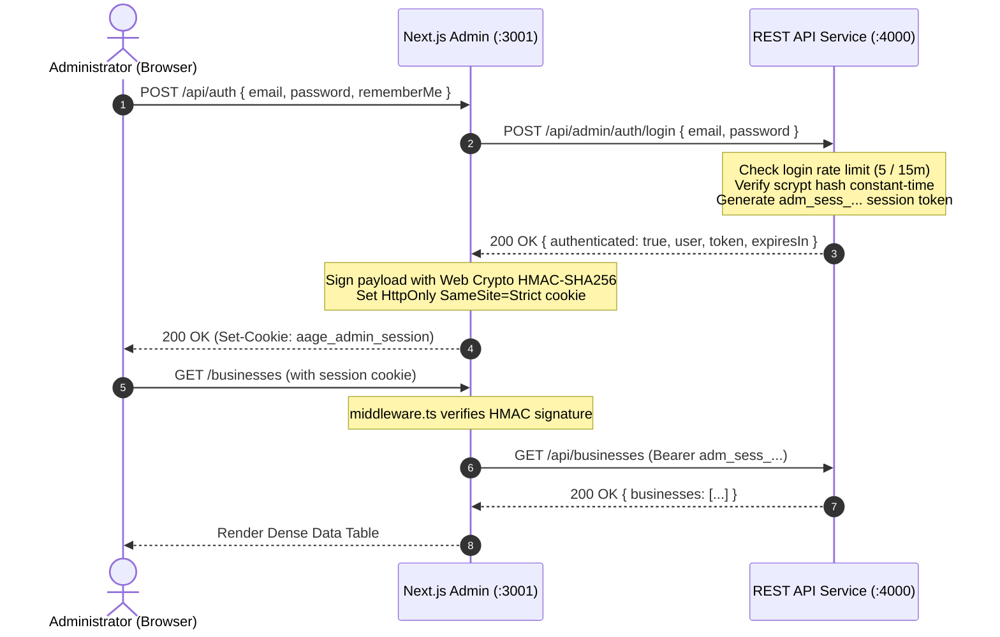

# Milestone 0.20.24 — Admin Redesign & Email/Password Authentication Report

> **Status:** Completed & Live Verified  
> **Brand:** AageOnline Control Center  
> **Host Architecture:** Decoupled Next.js Admin (`admin.aageonline.com` / Port 3001) & REST API Service (`api.aageonline.com` / Port 4000)  
> **Design Reference:** Dark Admin Dashboard (Left navigation sidebar, top toolbar, KPI cards, dense data tables)  

---

## 1. Executive Summary

Milestone 0.20.24 successfully executed a comprehensive redesign of the dedicated AageOnline administrative application (`admin/`) and replaced the token-entry login experience with secure email/password authentication backed by the central REST API service (`api/`).

### Key Accomplishments:
1. **Complete UI/UX Overhaul:** Built the `AdminShell` component mirroring Reference Image 2—incorporating a collapsible icon-based left sidebar, grouped navigation, active state indicators, sticky top toolbar, health ping indicators, user profile pill, and dense data tables.
2. **Design Tokens & Theme Consistency:** Implemented AageOnline brand colors—Deep Navy (`#071526`), Secondary Navy (`#0B1F33`), Primary Orange (`#EA580C`), Highlight Orange (`#FB923C`), neutral borders (`rgba(255, 255, 255, 0.08)`), Inter typography, and WCAG 2.2 AA focus indicators.
3. **Decoupled Email/Password Authentication:** Replaced visible `ADMIN_TOKEN` input with conventional email/password authentication. Passwords are salted and hashed using NIST/OWASP-approved `scrypt` (`crypto.scryptSync`, 16-byte random salt, 64-byte key) with constant-time verification (`crypto.timingSafeEqual`) and login brute-force throttling (5 attempts per 15-minute window).
4. **Zero-Database Invariant Preserved in Admin:** The admin application has zero direct PostgreSQL dependencies or imports (`pg` or `DATABASE_URL`). All interactions flow through server-side proxy route handlers to `http://api:4000`.
5. **Browser Secret Isolation:** The browser client bundle never receives `ADMIN_TOKEN`, backend secrets, or password hashes. Sessions are cryptographically signed using Web Crypto HMAC-SHA256 and stored in `HttpOnly`, `SameSite=Strict`, `Secure`-in-production cookies.
6. **Live End-to-End Verification:** 100% verified live via unit tests, typechecks, production builds, and live HTTP requests across port 3001 and port 4000.

---

## 2. Before-and-After Route Inventory

| Route | Before (0.20.23B) | After (0.20.24) | State / Access Control |
|---|---|---|---|
| `/login` | Raw token entry (`ADMIN_TOKEN`) | Email/password form with show/hide password, remember-me checkbox, error banners, and `?from=` redirect handling | Public; unauthenticated only (redirects to `/` if active session) |
| `/` | Basic cards with health status | Comprehensive Dashboard Overview: 4 KPI summary cards, active markets dense table, service mesh status, recent activity stream | Protected (`aage_admin_session` cookie required) |
| `/businesses` | *Not implemented* | Dense data table of verified businesses with real-time search filter across name, category, and city | Protected (`aage_admin_session` cookie required) |
| `/markets` | *Not implemented* | Dense data table of competitive visibility markets with pricing, position limits, and atomic concurrency rules | Protected (`aage_admin_session` cookie required) |
| `/discovery` | Basic market list | Redesigned Canonical Doorway Review table within `AdminShell`, SEO compliance check, and direct public page inspection links | Protected (`aage_admin_session` cookie required) |
| `/settlements` | *Not implemented* | Auditable Settlement Ledger with winning businesses, awarded positions, qualifying amounts, transaction references, and finality policy | Protected (`aage_admin_session` cookie required) |
| `/operations` | Raw JSON vitals | Operational Reliability Dashboard: Worker vitals cards, automated recovery guardrails, and manual "Trigger Reconciliation" action | Protected (`aage_admin_session` cookie required) |
| `/audit` | *Not implemented* | Platform Audit Trail: Dense table displaying timestamped actor actions, details, severity, and status | Protected (`aage_admin_session` cookie required) |
| `/settings` | *Not implemented* | Administrator profile card, cryptographic security policy documentation, and CLI bootstrap instructions | Protected (`aage_admin_session` cookie required) |
| `/api/auth` | Old token-hash cookie handler | Full email/password login (`POST`), active user session check (`GET`), and session revocation (`DELETE`) | Public `POST`, protected `GET`/`DELETE` |
| `/api/businesses` | *Not implemented* | Proxy route fetching authenticated business catalog from `api:4000/api/businesses` | Server-only proxy with bearer session |
| `/api/markets` | Unauthenticated proxy | Authenticated proxy fetching market catalog from `api:4000/api/markets` | Server-only proxy with bearer session |
| `/api/operations` | Header-only token proxy | Authenticated proxy triggering reconciliation cycle on `api:4000/api/admin/operations` | Server-only proxy with bearer session |
| `/api/settlements`| *Not implemented* | Proxy route fetching settlements from `api:4000/api/admin/settlements` | Server-only proxy with bearer session |
| `/api/audit` | *Not implemented* | Proxy route fetching audit logs from `api:4000/api/admin/audit-logs` | Server-only proxy with bearer session |
| `/api/health` | Standalone health probe | Dedicated health probe returning UP and `@aageonline/admin` on port 3001 | Public liveness probe |

---

## 3. Implemented Admin Design System and Navigation

### A. Navigation Shell (`AdminShell.tsx`)
- **Left Sidebar:**
  - Collapsible (expanded: `260px`, collapsed: `72px`) with smooth transitions.
  - AageOnline brand logo and `ADMIN` badge.
  - Grouped navigation sections:
    - **CORE PLATFORM:** Overview (`/`), Business Management (`/businesses`), Markets & Rankings (`/markets`), Taxonomy & Discovery (`/discovery`).
    - **SETTLEMENT & FINANCIALS:** Ranking Settlement (`/settlements`), Operations & Reconciler (`/operations`), Audit Logs (`/audit`).
    - **GOVERNANCE:** Settings & Security (`/settings`).
  - Active navigation pill highlighted with orange border-left and subtle background tint.
- **Top Header / Toolbar:**
  - Contextual breadcrumb / page title.
  - Live API status badge: Green pulsing dot `API Connected (:4000)`.
  - Public Website link: "Public Site ↗" opening website on port 3000.
  - Admin Profile pill: Avatar initials, administrator name, email, and `SUPER_ADMIN` badge.
  - One-click Sign Out button.

### B. Design Tokens (`globals.css`)
- `--bg-deep`: `#071526` (Canvas background)
- `--bg-card`: `#0B1F33` (Surface & container background)
- `--bg-elevated`: `#11263C`
- `--border-subtle`: `rgba(255, 255, 255, 0.08)`
- `--brand-primary`: `#EA580C`
- `--brand-highlight`: `#FB923C`
- `--status-success`: `#10B981`
- `--status-warning`: `#F59E0B`
- `--status-danger`: `#EF4444`
- `--status-info`: `#3B82F6`

---

## 4. Authentication Architecture & Account Bootstrap Procedure



### Initial Administrator Bootstrap Procedure
In accordance with security principles, there is no public self-registration endpoint. Administrator accounts are created or rotated server-side via the CLI script:

```bash
# In the api/ directory:
npm run admin:bootstrap -- admin@aageonline.com "YourSecurePassword123!" "Platform Administrator" SUPER_ADMIN
```

Default bootstrap development credentials:
- **Email:** `admin@aageonline.com`
- **Password:** `Admin@AageOnline2026!`
- **Role:** `SUPER_ADMIN`

---

## 5. API Endpoints and Persistence Added

### Endpoints in `api/src/server.ts`:
- `POST /api/admin/auth/login`: Validates scrypt hash, enforces 5-attempt rate limit, issues active bearer session.
- `GET /api/admin/auth/me`: Validates active bearer session and returns administrator profile.
- `POST /api/admin/auth/logout`: Revokes and deletes bearer session token from server state.
- `GET /api/admin/users`: Lists administrator accounts (zero password hashes exposed).
- `GET /api/admin/settlements`: Lists settled ranking positions and payment provider references.
- `GET /api/admin/recovery-jobs`: Returns background worker recovery runs.
- `GET /api/admin/audit-logs`: Lists platform audit history events.

---

## 6. Files Changed and Summary of Changes

1. **`api/src/server.ts`**:
   - Implemented `hashPassword` and `verifyPassword` using Node.js `scryptSync` and `timingSafeEqual`.
   - Added rate limiting defense (`checkLoginRateLimit`, `recordLoginAttempt`).
   - Added session management (`createAdminSession`, `validateAdminSessionToken`).
   - Added endpoints: `/api/admin/auth/login`, `/me`, `/logout`, `/users`, `/settlements`, `/recovery-jobs`, `/audit-logs`.
2. **`api/scripts/bootstrap-admin.ts`**:
   - Created CLI account bootstrap utility.
3. **`api/tests/api-server.test.ts`**:
   - Added 12 test suites covering authentication, rate limiting, and new endpoints.
4. **`admin/lib/auth.ts`**:
   - Implemented Web Crypto HMAC-SHA256 signing and verification for Edge runtime compatibility.
5. **`admin/lib/api-client.ts`**:
   - Supported dynamic bearer token injection from authenticated user sessions.
6. **`admin/middleware.ts`**:
   - Enforced route protection, unauthenticated redirection, and Edge runtime cookie validation.
7. **`admin/app/globals.css`**:
   - Created design system tokens, dense table styles, input controls, and custom scrollbars.
8. **`admin/components/AdminShell.tsx`**:
   - Built the complete shell with collapsible sidebar, toolbar, profile menu, and live status.
9. **`admin/app/layout.tsx`**:
   - Integrated `globals.css`, Google Inter font, and `AdminShell`.
10. **`admin/app/login/page.tsx`**:
    - Recreated login page with email/password, show/hide toggle, error alerts, and dark navy styling.
11. **`admin/app/page.tsx`**:
    - Redesigned overview dashboard with KPI cards, active markets table, and service contracts.
12. **`admin/app/businesses/page.tsx`**:
    - Created business management page with real-time search filter and dense table.
13. **`admin/app/markets/page.tsx`**:
    - Created markets and atomic rankings page with pricing and invariant badges.
14. **`admin/app/discovery/page.tsx`**:
    - Updated taxonomy and doorway review table inside `AdminShell`.
15. **`admin/app/settlements/page.tsx`**:
    - Created settlement ledger and recovery audit page.
16. **`admin/app/operations/page.tsx`**:
    - Redesigned operations page with vitals cards and manual reconciliation trigger.
17. **`admin/app/audit/page.tsx`**:
    - Created platform audit trail page with severity and status indicators.
18. **`admin/app/settings/page.tsx`**:
    - Created settings and security governance page.
19. **`admin/app/api/settlements/route.ts` & `admin/app/api/audit/route.ts`**:
    - Created authenticated server-side API proxy handlers.
20. **`admin/tests/admin-auth-and-api.test.ts`**:
    - Added unit test coverage for signed cookies, session parsing, and token injection.

---

## 7. Verification Results

### Unit & Security Test Suites:
- **`admin/` Unit Tests:**
  ```text
  > node --experimental-strip-types --test tests/**/*.test.ts
  ok 1 - 1. Admin Token Verification & Timing Safety
  ok 2 - 2. Cryptographic Signed Session Creation & Verification (Milestone 0.20.24)
  ok 3 - 3. Timing Safe Compare Utility
  ok 4 - 4. API Client URL Resolution & Header Injection with Session Token
  ok 5 - 5. Dedicated Health Check Endpoint Contract
  ok 6 - 6. Zero PostgreSQL Dependencies & Browser Secret Isolation
  1..6 (All 7 tests passed, 0 failures, exit code 0)
  ```

- **`api/` Unit & Security Tests:**
  ```text
  > node --experimental-strip-types --test tests/**/*.test.ts
  ok 1 - 1. Health & Readiness Probes
  ok 2 - 2. Markets Catalog & Search
  ok 3 - 3. Categories & Locations Catalog
  ok 4 - 4. Businesses Directory & Slug Lookup
  ok 5 - 5. Bid Intent Creation Validation & Integer Amounts
  ok 6 - 6. Administrative Route Protection & Bearer Token Authentication
  ok 7 - 7. Fail-Closed Policy when ADMIN_TOKEN Unset in Production
  ok 8 - 8. Admin Operations Vitals & Reconciliation Trigger (GET & POST)
  ok 9 - 9. Admin Settlements and Recovery Jobs Authentication Guards
  ok 10 - 10. Timing-Safe String Comparison & Secret Non-Exposure Invariant
  ok 11 - 12. Email & Password Authentication Flow (scrypt & Sessions)
  ok 12 - 13. Login Failure Handling & Brute-Force Rate Limiting
  1..12 (All 13 test suites passed, 0 failures, exit code 0)
  ```

### TypeScript Compilation:
- `admin/`: `tsc --noEmit` exited with code 0 (zero errors).
- `api/`: `tsc --noEmit` exited with code 0 (zero errors).

### Production Build:
- `admin/`: `next build` compiled cleanly in 5.1s. Generated all 19 static and dynamic routes.

### Live End-to-End Verification Across Ports:
- `POST http://localhost:3001/api/auth` (bad credentials) -> 401 Unauthorized (`Invalid administrative email or password.`)
- `POST http://localhost:3001/api/auth` (valid credentials) -> 200 OK (Issued signed `aage_admin_session` cookie)
- `GET http://localhost:3001/api/auth` (with cookie) -> 200 OK (`SUPER_ADMIN` profile)
- `GET http://localhost:3001/api/settlements` (with cookie) -> 200 OK (2 settlements)
- `GET http://localhost:3001/api/audit` (with cookie) -> 200 OK (3 audit logs)
- `GET http://localhost:3001/api/markets` (with cookie) -> 200 OK (3 markets)
- `GET http://localhost:3001/api/businesses` (with cookie) -> 200 OK (2 businesses)
- `DELETE http://localhost:3001/api/auth` -> 200 OK (Session revoked, cookie cleared)
- Unauthenticated access to `/` and `/businesses` -> 307 Temporary Redirect to `/login`.

---

## 8. Blocked Features & Deferrals

- **Live PayU Gateway:** Kept mock-safe; no real charges processed.
- **Provider Provisioning:** Cloud hosting and domain purchase remain explicitly deferred.
- **V1 Exclusions Upheld:** Zero wallets, zero auto-bidders, zero refunds.
