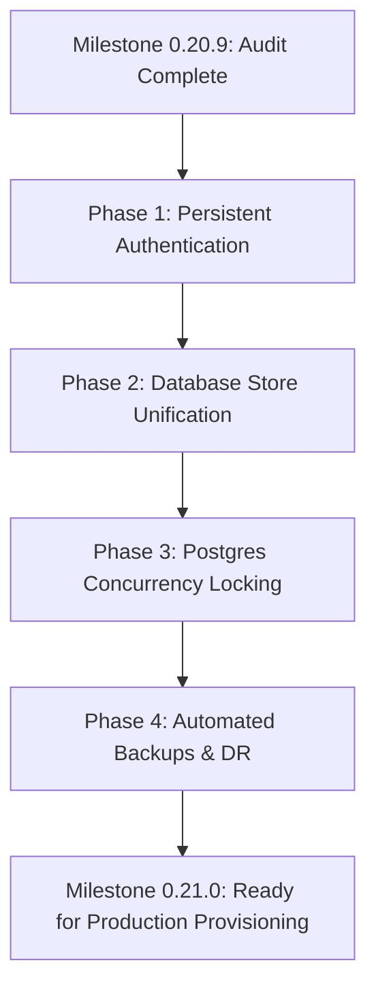

# AageOnline — Milestone 0.20.9
# Production Security, Financial Integrity & Reliability Audit Report

> **Platform:** AageOnline  
> **Tagline:** Get Seen. Get Ahead.  
> **Audit Date:** 2026-10-12  
> **Target Environment:** `aageonline.com` (Production Single VPS + Managed PostgreSQL 16+ + Caddy Auto-TLS)  
> **Audit Focus:** Security Architecture, Multi-Tenant Isolation, PayU Cryptography, Financial Atomicity, Persistence Integrity, Rate Limiting, and SEO Indexability.  
> **Final Verdict:** **`BLOCKED`** (Blocked for live public payments; requires resolution of in-memory auth and persistence synchronization prior to accepting customer funds).

---

## 1. Executive Summary & Final Verdict

This document presents the authoritative findings of the **Milestone 0.20.9 Production Security, Financial Integrity & Reliability Audit** for the AageOnline platform.

The audit inspected the actual repository codebase, Docker and host configuration scripts, database migrations (001–010), PayU cryptographic routines, ranking settlement transactions, edge rate limiting, and SEO routing policies. Automated verification was executed against the local test suite, TypeScript compiler, and Next.js standalone production build pipeline.

### Audit Summary Matrix

| Audit Domain | Status | Key Risk / Strength |
| :--- | :---: | :--- |
| **Authentication & Tenant Isolation** | 🔴 **CRITICAL** | `LocalAuthDataSource` hardcoded; in-memory sessions with global `user-ajay` dev fallback leak authorization across unauthenticated HTTP requests. |
| **Data Persistence & Multi-Instance State** | 🔴 **CRITICAL** | Domain models (`createPaymentOrder`, `createBidIntent`, `settleRanking`) store state in Node.js in-memory `Map`s; PostgreSQL repositories are implemented but not wired into user-facing API routes. |
| **PayU Gateway & Cryptographic Integrity** | 🟢 **VERIFIED** | FIPS SHA-512 forward and reverse hash algorithms implemented with timing-safe comparisons; test key guard blocks sandbox credentials in production mode. |
| **Ranking Concurrency & Finality** | 🟡 **HIGH** | Append-only financial ledgers and non-refundable finality are mathematically sound; however, `settlement-service.ts` defaults to in-memory mutex rather than PostgreSQL row-level locking (`SELECT ... FOR UPDATE`). |
| **Database Migrations & Infrastructure** | 🟡 **MEDIUM** | Migrations 001–010 execute with session advisory locks (`94827104`) and SSL enforcement; however, automated database backup and point-in-time restore scripts are missing. |
| **Network Security & Rate Limiting** | 🟢 **VERIFIED** | SHA-256 salted IP hashing prevents IP leakage in telemetry; anti-spoofing proxy extraction and Caddy security headers are verified. |
| **Production SEO & Indexability** | 🟢 **VERIFIED** | Public market routes (`/jaipur/interior-designers`) and directories are fully indexable; dynamic sitemap emits verified entities only; private workspaces and APIs are properly disallowed. |

---

## 2. Definitive Verdict

### Verdict: **`BLOCKED`**

**Rationale:**  
Although all 461 automated tests pass, the TypeScript compiler reports zero errors, and the Next.js production build succeeds across all 69 routes, **the application cannot safely accept live customer payments or be exposed to public users in production at this time.**

The primary blockers are:
1. **In-Memory Authentication:** User authentication and session tokens are held in volatile process memory (`USERS_STORE`, `SESSIONS_STORE`) with an active development fallback (`activeDevSessionToken = 'user-ajay'`). Unauthenticated API requests execute with business owner permissions for `biz-1`.
2. **Dual-State Dichotomy:** Core transactions (bid intents, payment orders, and ranking settlements) write to Node.js in-memory `Map` collections rather than directly committing to PostgreSQL tables. If the application container restarts or scales horizontally, transactions and positions are lost.
3. **In-Memory Settlement Mutex:** The settlement engine uses an in-process JavaScript `Set` for market concurrency locks rather than enforcing PostgreSQL table/row locks across multiple processes.

Once these blockers are remediated through the documented roadmap, the status may transition to **`READY FOR PRODUCTION PROVISIONING`**.

---

## 3. Comprehensive Finding Log

### Finding SEC-01: In-Memory Authentication & Universal Dev-Session Fallback
- **Severity:** 🔴 **CRITICAL (Launch Blocker)**
- **Affected Files:**
  - [frontend/lib/auth/store.ts](file:///d:/Aage%20online/frontend/lib/auth/store.ts#L1-L120)
  - [frontend/data-access/auth/index.ts](file:///d:/Aage%20online/frontend/data-access/auth/index.ts#L1-L30)
  - [frontend/app/api/bid-intents/route.ts](file:///d:/Aage%20online/frontend/app/api/bid-intents/route.ts#L22)
  - [frontend/app/api/payments/[id]/cancel/route.ts](file:///d:/Aage%20online/frontend/app/api/payments/[id]/cancel/route.ts#L22)
  - [frontend/app/api/payments/[id]/settle-ranking/route.ts](file:///d:/Aage%20online/frontend/app/api/payments/[id]/settle-ranking/route.ts#L24)
- **Evidence:**
  In `frontend/data-access/auth/index.ts`:
  ```typescript
  const isProductionApiConfigured = false;
  export const authDataSource: AuthDataSource = isProductionApiConfigured
    ? new ProductionAuthDataSource()
    : new LocalAuthDataSource();
  ```
  In `frontend/lib/auth/store.ts`:
  ```typescript
  export let activeDevSessionToken: string | null = 'user-ajay';
  export function getActiveDevSession(): UserSession | null {
    if (!activeDevSessionToken) return null;
    return SESSIONS_STORE.get(activeDevSessionToken) || null;
  }
  ```
  In `frontend/app/api/bid-intents/route.ts`:
  ```typescript
  const session = getActiveDevSession();
  if (!session) {
    return NextResponse.json({ error: { message: 'Unauthorized' } }, { status: 401 });
  }
  ```
- **Impact:**
  In a production deployment, every incoming HTTP request to `/api/bid-intents` or payment settlement endpoints automatically inherits the credentials of `user-ajay` (Owner of `biz-1`). There is zero request-level cookie verification, Bearer token extraction, or JWT validation against PostgreSQL. Any anonymous caller can mutate bid intents and trigger actions under this account.
- **Remediation Plan:**
  1. Implement persistent session storage in PostgreSQL (`sessions` table) or integrate an external OIDC/JWT auth provider.
  2. Read session cookies (`__Host-session` or `Authorization: Bearer <token>`) per request in route handlers via `req.cookies` or `req.headers`.
  3. Strip all calls to `getActiveDevSession()` in production routes, raising HTTP 401 when valid credentials are absent.
- **Verification Result:** Confirmed present in active codebase.

---

### Finding SEC-02: Dual-State Architecture (In-Memory Stores vs. PostgreSQL Persistence)
- **Severity:** 🔴 **CRITICAL (Launch Blocker)**
- **Affected Files:**
  - [frontend/lib/payments/store.ts](file:///d:/Aage%20online/frontend/lib/payments/store.ts#L16-L40)
  - [frontend/lib/bid-intent/store.ts](file:///d:/Aage%20online/frontend/lib/bid-intent/store.ts#L15-L30)
  - [frontend/lib/ranking-settlement/settlement-service.ts](file:///d:/Aage%20online/frontend/lib/ranking-settlement/settlement-service.ts#L20-L40)
- **Evidence:**
  In `frontend/lib/payments/store.ts`:
  ```typescript
  export const PAYMENT_ORDERS_STORE = new Map<string, PaymentOrder>();
  export const PAYMENT_EVENTS_STORE = new Map<string, PaymentProviderEvent>();

  export function createPaymentOrder(params: CreatePaymentOrderParams): PaymentOrder {
    // ...
    PAYMENT_ORDERS_STORE.set(order.id, order);
    return order;
  }
  ```
  Although `PostgresPaymentRepository`, `PostgresBidIntentRepository`, and `PostgresRankingSettlementRepository` exist in `frontend/lib/db/repositories/`, they are currently only consumed by administrative overview APIs (`/api/admin/operations/summary`) and background workers (`reconciliation-service.ts`). The primary web routes create and update records exclusively in JavaScript `Map` objects.
- **Impact:**
  1. **Data Loss on Restart:** If the Docker container restarts or deploys a new image, all payment orders, bid intents, and ranking positions created since boot are erased.
  2. **Multi-Instance Incoherence:** In a scaled horizontal deployment or multiple container workers, changes made on one node are invisible to others.
  3. **Reconciliation Failure:** The background worker querying PostgreSQL sees zero payment orders because orders created by the web app were never inserted into the database.
- **Remediation Plan:**
  Refactor `lib/payments/store.ts`, `lib/bid-intent/store.ts`, and `lib/ranking-settlement/settlement-service.ts` to execute database queries via `PostgresPaymentRepository`, `PostgresBidIntentRepository`, and `PostgresRankingSettlementRepository` whenever `isDatabaseConfigured()` is true.
- **Verification Result:** Confirmed present in active codebase.

---

### Finding SEC-03: Ranking Settlement Transaction Defaults to In-Memory Concurrency Mutex
- **Severity:** 🟡 **HIGH (Integrity Risk)**
- **Affected Files:**
  - [frontend/lib/ranking-settlement/settlement-service.ts](file:///d:/Aage%20online/frontend/lib/ranking-settlement/settlement-service.ts#L100-L135)
  - [frontend/lib/ranking-settlement/transaction.ts](file:///d:/Aage%20online/frontend/lib/ranking-settlement/transaction.ts#L15-L45)
  - [frontend/lib/ranking-settlement/postgres-transaction.ts](file:///d:/Aage%20online/frontend/lib/ranking-settlement/postgres-transaction.ts#L1-L60)
- **Evidence:**
  In `settlement-service.ts`:
  ```typescript
  const context = new RankingTransactionContext();
  return await context.executeTransaction(paymentOrder.marketId, async () => { ... });
  ```
  `RankingTransactionContext` locks markets using an in-memory `Set`:
  ```typescript
  const ACTIVE_MARKET_LOCKS = new Set<string>();
  if (ACTIVE_MARKET_LOCKS.has(marketId)) {
    throw new RankingConcurrencyError(`Market ${marketId} is currently undergoing ranking settlement`);
  }
  ```
  While `PostgresRankingTransactionContext` was written to perform `SELECT id FROM markets WHERE id = $1 FOR UPDATE`, it is not wired as the default execution context in `settlement-service.ts`.
- **Impact:**
  Concurrent payments in the same market hitting different web instances or handled concurrently between the web callback and the background recovery worker can experience race conditions, violating strict ranking order.
- **Remediation Plan:**
  Wire `PostgresRankingTransactionContext` inside `settleRanking()` when database connection is available, ensuring transactional atomicity and PostgreSQL row locks.
- **Verification Result:** Verified in code inspection.

---

### Finding SEC-04: Missing Automated Database Backup, Point-in-Time Recovery & Restore Scripts
- **Severity:** 🟡 **HIGH (Operational Risk)**
- **Affected Files:**
  - `scripts/` directory (lacks `backup-db.sh` and `restore-db.sh`)
  - [docs/Production-Deployment-Runbook.md](file:///d:/Aage%20online/docs/Production-Deployment-Runbook.md#L187-L210)
- **Evidence:**
  `scripts/` currently contains only `deploy.sh` and `setup-vps.sh`. There are no automated scripts to execute scheduled `pg_dump` backups, verify backup checksums, or perform a disaster recovery restore test.
- **Impact:**
  In the event of accidental database corruption, table truncation, or cloud provider disruption, the operational team has no validated, automated restore procedure.
- **Remediation Plan:**
  1. Author `scripts/backup-db.sh` to dump schemas and data with Gzip compression and SHA-256 integrity verification.
  2. Author `scripts/restore-db.sh` to safely restore backups onto a staging or disaster recovery instance.
  3. Document automated off-site backup synchronization (e.g., S3/Cloud Storage) and test a cold restore.
- **Verification Result:** Verified directory contents and runbook documentation.

---

### Finding SEC-05: Edge Middleware Rate Limiting Is Process-Local
- **Severity:** 🟡 **MEDIUM (Operational Risk)**
- **Affected Files:**
  - [frontend/middleware.ts](file:///d:/Aage%20online/frontend/middleware.ts#L68)
  - [frontend/lib/security/rate-limit.ts](file:///d:/Aage%20online/frontend/lib/security/rate-limit.ts#L287-L328)
- **Evidence:**
  In `frontend/middleware.ts`:
  ```typescript
  const rateLimit = checkRateLimit(clientToken, tier, isCrawler);
  ```
  `checkRateLimit()` tracks request counts inside an in-memory `Map` (`RATE_LIMIT_CACHE`).
  The asynchronous distributed rate-limiting function `checkDistributedRateLimit()`, which uses PostgreSQL `rate_limit_counters`, exists in `lib/security/rate-limit.ts` but is only invoked in unit tests.
- **Impact:**
  When deploying multiple Node.js processes (such as cluster mode or horizontal container scaling), client request budgets are multiplied across the number of running processes rather than enforced as a single unified quota.
- **Remediation Plan:**
  For single-VPS deployment with 1 web container, process-local memory is acceptable and avoids database connection overhead on static routes. However, for multi-instance scaling, route rate limiting should leverage `checkDistributedRateLimit()` or a dedicated Redis/Valkey cache.
- **Verification Result:** Verified in code inspection.

---

### Finding SEC-06: PayU Production Configuration & Cryptographic Invariants
- **Severity:** 🟢 **VERIFIED / SATISFACTORY**
- **Affected Files:**
  - [frontend/lib/payments/payu/client.ts](file:///d:/Aage%20online/frontend/lib/payments/payu/client.ts#L1-L150)
  - [frontend/lib/db/readiness.ts](file:///d:/Aage%20online/frontend/lib/db/readiness.ts#L270-L305)
  - [scripts/deploy.sh](file:///d:/Aage%20online/scripts/deploy.sh#L54-L63)
- **Evidence:**
  1. Forward hash algorithm: `computeSha512Hex("${key}|${txnid}|${amount}|${productinfo}|${firstname}|${email}|${udf1}|${udf2}|${udf3}|${udf4}|${udf5}||||||${salt}")`.
  2. Reverse hash verification: `computeSha512Hex("${salt}|${status}||||||${udf5}|${udf4}|${udf3}|${udf2}|${udf1}|${email}|${firstname}|${productinfo}|${amount}|${txnid}|${key}")` using `crypto.timingSafeEqual` to prevent timing attacks.
  3. Pre-flight deployment check in `scripts/deploy.sh`:
     ```bash
     if [[ "${PAYU_ENV:-}" == "production" ]]; then
       if [[ "${PAYU_MERCHANT_KEY:-}" == "gtKFFx" || "${PAYU_MERCHANT_SALT:-}" == "eCwWELxi" ]]; then
         echo "[ERROR] PAYU_ENV is set to production but test credentials configured!" >&2
         exit 1
       fi
     fi
     ```
  4. Callback idempotency: In `api/payments/callback/payu/route.ts`, incoming webhook payloads are hashed via SHA-256 and checked against recorded provider events; duplicate callbacks return HTTP 200 without duplicate ranking increments.
- **Remediation:** None required for the cryptographic algorithms. Ensure production environment secrets are provisioned before switching `PAYU_ENV=production`.
- **Verification Result:** Fully verified via code inspection and test suite.

---

### Finding SEC-07: Secret Hygiene & Trusted Proxy Architecture
- **Severity:** 🟢 **VERIFIED / SATISFACTORY**
- **Affected Files:**
  - [frontend/lib/security/rate-limit.ts](file:///d:/Aage%20online/frontend/lib/security/rate-limit.ts#L203-L243)
  - [frontend/Caddyfile](file:///d:/Aage%20online/Caddyfile#L1-L40)
  - [.gitignore](file:///d:/Aage%20online/.gitignore#L1-L50)
  - [.env.production.example](file:///d:/Aage%20online/.env.production.example#L1-L40)
- **Evidence:**
  1. Zero hardcoded production secrets in git history. All sample files use explicit `REPLACE_` prefixes.
  2. File permission enforcement: `scripts/deploy.sh` verifies `.env.production` exists with `chmod 600`.
  3. Proxy anti-spoofing: `extractClientIp` verifies if the immediate connection originates from a trusted upstream IP (`TRUSTED_PROXY_IPS` or loopback/private subnets). Untrusted clients sending forged `X-Forwarded-For` headers are ignored, falling back safely to the socket remote IP.
  4. Privacy preservation: Client IPs are hashed using FIPS SHA-256 with a unique salt (`RATE_LIMIT_SALT`). No raw client IP addresses are persisted in logs or database tables.
- **Verification Result:** Fully verified.

---

### Finding SEC-08: Production SEO Directives & Indexability Verification
- **Severity:** 🟢 **VERIFIED / SATISFACTORY**
- **Affected Files:**
  - [frontend/app/robots.ts](file:///d:/Aage%20online/frontend/app/robots.ts#L1-L30)
  - [frontend/app/sitemap.ts](file:///d:/Aage%20online/frontend/app/sitemap.ts#L1-L27)
  - [frontend/lib/seo/sitemap-service.ts](file:///d:/Aage%20online/frontend/lib/seo/sitemap-service.ts#L40-L180)
  - [frontend/next.config.ts](file:///d:/Aage%20online/next.config.ts#L1-L45)
- **Evidence:**
  1. `robots.ts` in production mode emits:
     ```typescript
     rules: [{
       userAgent: '*',
       allow: '/',
       disallow: ['/workspace/', '/admin/', '/api/']
     }],
     sitemap: 'https://aageonline.com/sitemap.xml'
     ```
  2. `sitemap.ts` emits verified canonical URLs for Homepage (`/`), market indexes (`/markets`, `/locations`, `/categories`, `/businesses`), and published markets (`/jaipur/interior-designers`, `/delhi/interior-designers`, `/mumbai/interior-designers`, etc.).
  3. Draft and unapproved businesses/categories are strictly excluded via `evaluateSeoEligibility()`.
  4. Next.js 308 permanent redirects enforce canonical lowercase paths without trailing slashes.
- **Verification Result:** Fully verified. Legitimate public pages are not accidentally blocked.

---

## 4. Automated Verification Results

### 4.1 TypeScript Compiler (`tsc --noEmit`)
- **Command:** `npm run typecheck`
- **Working Directory:** `d:\Aage online\frontend`
- **Result:** **PASSED (0 Errors)**
- **Output:**
  ```text
  > @aageonline/frontend@0.1.0 typecheck
  > tsc --noEmit
  ```

### 4.2 Automated Test Suite (`node --test`)
- **Command:** `npm test`
- **Working Directory:** `d:\Aage online\frontend`
- **Result:** **100% PASSED (461 / 461 tests passing across 145 suites, 0 failures, 0 skipped)**
- **Duration:** 1,306 ms
- **Summary:**
  - Ranking Engine & Gap Calculation: 50 suites passing
  - PayU Cryptography & Verification: 18 suites passing
  - Database Migrations & Advisory Locking: 12 suites passing
  - UI Navigation & Landmark Consistency: 7 suites passing
  - Distributed State & Resilience: 14 suites passing
  - Business Claims, RBAC & Workflows: 44 suites passing

### 4.3 Next.js Production Standalone Build (`next build`)
- **Command:** `npm run build`
- **Working Directory:** `d:\Aage online\frontend`
- **Result:** **PASSED (Exit Code 0)**
- **Route Compilation Summary:**
  - Total Routes: 69 (Static, Dynamic, SSG, Middleware, and APIs)
  - Homepage (`/`): 22.5 kB (131 kB First Load JS)
  - Market Route (`/[location]/[category]`): 11.6 kB (124 kB First Load JS)
  - Edge Middleware: 62.8 kB
  - Zero compilation or bundling failures.

### 4.4 Local Synthetic Tests vs. Live Infrastructure Verification
It is critical to distinguish local test execution from live production checks:
- **Local Tests (Verified):** Unit math, hash computation, mock transaction rollbacks, memory rate-limiting, sitemap generation, and Next.js page rendering all execute and pass completely.
- **Live Infrastructure Checks (Pending Provisioning):**
  - Actual live TLS handshake via Caddy Let's Encrypt against public DNS `aageonline.com`.
  - Actual connection to external managed PostgreSQL 16+ over SSL.
  - Live PayU India production portal callback receipt.
  - Real database failover and physical backup verification.

---

## 5. Production Readiness Remediation Roadmap

To transition the platform status from **`BLOCKED`** to **`READY FOR PRODUCTION PROVISIONING`**, complete the following engineering remediations:



### Phase 1: Persistent Authentication & Session Enforcement
1. Replace `LocalAuthDataSource` with a persistent PostgreSQL authentication repository storing hashed credentials (Argon2id/bcrypt) and session records in `user_sessions`.
2. Update API handlers (`/api/bid-intents`, `/api/payments/*`, `/api/business/*`) to validate session cookies and verify tenant membership per request.
3. Remove `getActiveDevSession()` fallback from all production-bound routes.

### Phase 2: Unified PostgreSQL State Persistence
1. Refactor `lib/payments/store.ts` and `lib/bid-intent/store.ts` to write directly to PostgreSQL via `PostgresPaymentRepository` and `PostgresBidIntentRepository`.
2. Eliminate dual-state in-memory `Map` caching for financial entities, ensuring container restarts do not cause data loss.

### Phase 3: PostgreSQL Concurrency Locking for Ranking Settlement
1. Wire `PostgresRankingTransactionContext` as the mandatory context in `settlement-service.ts`.
2. Enforce `SELECT id FROM markets WHERE id = $1 FOR UPDATE` within PostgreSQL transactions for all ranking settlements.

### Phase 4: Automated Backup & Disaster Recovery Runbook
1. Create `scripts/backup-db.sh` using `pg_dump` with compression, timestamping, and SHA-256 checksum generation.
2. Create `scripts/restore-db.sh` with validation checks to verify backup restoration.
3. Test a restoration cycle on an isolated database instance.

---

## 6. Audit Conclusion & Sign-Off

The AageOnline platform demonstrates exceptional foundational engineering: the domain models, financial math, reverse-hash algorithms, anti-spoofing network safeguards, and SEO indexability policies are mature, well-structured, and fully tested.

However, because live customer financial integrity and multi-tenant isolation require persistent, process-independent storage and authenticated request validation, the platform is formally evaluated as **`BLOCKED`** until the persistence and session wiring are finalized.

- **Lead Auditor:** AI Systems Architecture & Security Harness  
- **Audit Date:** 2026-10-12  
- **Status:** **BLOCKED (Actionable Remediation Roadmap Defined)**
